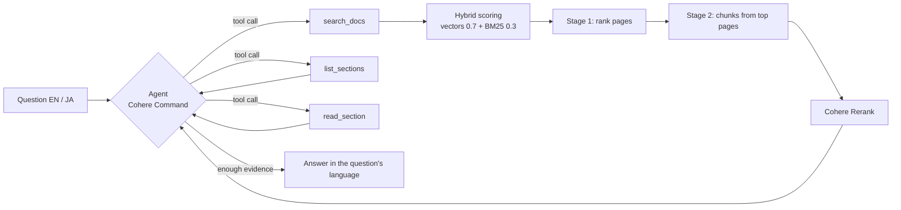

# docs-agent

A tool-using RAG agent that answers questions about the [FastAPI tutorial](https://fastapi.tiangolo.com/tutorial/) in **English and Japanese**, built on Cohere (Command, Embed, Rerank), with a **deterministic evaluation** that compares the agent against single-shot RAG.

Example session (illustrative):

```
$ docs-agent ask "My React app on localhost:3000 is blocked when calling my API. What do I add?" --trace
[1] search_docs({'query': 'CORS allow frontend origin localhost:3000'})
[2] read_section({'section_id': 'en/tutorial/cors#5'})

Add CORSMiddleware with allow_origins=["http://localhost:3000"] ...
```

## Why an agent, not just RAG

Single-shot RAG embeds the user's question, takes the top chunks and answers. That fails when the question uses different words than the docs, when the answer needs a detail cut off in a snippet, or when the best source is in the other language.

The agent plans and uses three tools until it has enough evidence:

| Tool | What it does |
|---|---|
| `search_docs(query, lang, top_k)` | Hybrid, two-stage search (below). The agent rewrites the query, retries, or switches language. |
| `list_sections(page_id)` | Outline of one page, to choose what to read. |
| `read_section(section_id)` | Full text of a section, when a snippet is not enough. |



## Retrieval design

- **Bilingual corpus:** the 51 tutorial pages in both English and Japanese (FastAPI `0.165.0`, pinned), split on headings into ~950 sections and ~1,000 chunks of at most 1,200 characters with 150 characters of overlap.
- **Hybrid scoring:** `embed-v4.0` vector similarity combined with BM25 keyword scores (0.7 / 0.3 after min-max normalization). Keywords matter in API docs, where exact names like `response_model_exclude_unset` carry the meaning.
- **Japanese keyword search without a tokenizer dependency:** Japanese has no spaces, so the BM25 tokenizer uses character bigrams for Japanese and words for Latin script.
- **Two-stage retrieval:** stage 1 ranks whole *pages* (best chunk + ¼ of the second best), so one page with two good matches beats scattered single hits. Stage 2 takes candidate chunks only from the top 3 pages, always including some from the best page, then **Cohere Rerank** orders them.
- **Headings in front of every chunk** before embedding, because a section titled "Data validation" means more than its first paragraph.

## Evaluation

`eval/questions.yaml` has 17 questions: 10 English, 6 Japanese, and 1 the tutorial doesn't cover. Scoring is done **in code, not by an LLM judge**, so results are reproducible:

- **Facts:** every required group of terms appears in the answer (for example `CORSMiddleware` *and* `allow_origins`).
- **Evidence:** the agent's tools returned or read the right page (either language edition counts).
- **Abstention:** for the uncovered question, the answer says the tutorial doesn't cover it instead of inventing.

Each question runs twice: as the **agent** and as the **single-shot RAG baseline** (one search with the raw question, then answer). The report also tracks tool calls, latency and tokens per question.

Results: see [`eval/results.md`](eval/results.md) (generated by `docs-agent eval`).

## Quick start

```bash
git clone https://github.com/ankhbayar479/docs-agent && cd docs-agent
uv sync
cp .env.example .env            # add your COHERE_API_KEY (a free trial key works)

uv run docs-agent ingest        # download the tutorial (EN + JA), split into sections
uv run docs-agent index         # chunk + embed with Cohere (~1,000 chunks)
uv run docs-agent ask "クエリパラメータを最大50文字に制限するには？" --trace
uv run docs-agent eval          # agent vs baseline -> eval/results.md
```

Tests run offline with fake Cohere clients (no key needed): `uv run pytest`.

## Project layout

```
src/docs_agent/
  ingest.py      download + clean markdown + split on headings
  text.py        EN/JA tokenizer, chunking with overlap
  index.py       chunks, Cohere embeddings, saved index
  retrieval.py   hybrid scoring, two-stage page -> chunk retrieval, rerank
  tools.py       tool schemas (Cohere format) + implementations
  agent.py       the plan / tool-call / observe loop, and the single-shot baseline
  evaluate.py    deterministic scoring and the results report
  cli.py         docs-agent ingest | index | ask | eval
eval/questions.yaml
tests/           offline tests with scripted fake clients
```

## Limits and next steps

- Questions are about one product's docs; a broader set would need more pages and harder multi-hop questions.
- Fact checks are string matches: strict and reproducible, but they can miss a correct answer phrased differently.
- Next: streaming answers with citations, a cost-per-question budget, and caching query embeddings.

## License

Code: MIT. The FastAPI documentation is © Sebastián Ramírez and contributors, MIT-licensed; it is downloaded at run time, not stored in this repository.
